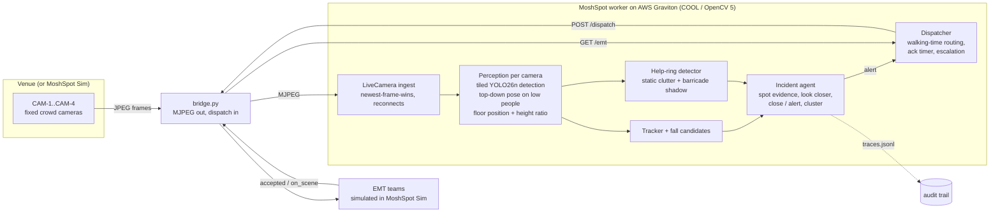
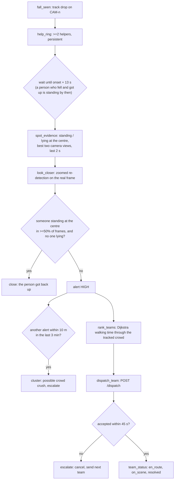

# MoshSpot — Technical Report

**Team:** Gofer AI · **Competition:** OpenCV AI Competition 2026, powered by AWS · **Repo:** this repository (branch `worker`)

MoshSpot turns the fixed crowd cameras a venue already owns into crowd spotters that never look away:

1. It sees a person collapse in a dense crowd and recognises the bystanders gathering around them.
2. An agent verifies the event, looking closer at the real pixels when unsure.
3. It pins the person on the venue map.
4. It sends the EMT team with the shortest walking time through the crowd, and escalates if nobody acknowledges.

Every OpenCV call runs through **OpenCV 5** (the new DNN engine and the calibration geometry). The system is built to run on **AWS Graviton with COOL**. It's evaluated closed-loop against **MoshSpot Sim**, a seeded concert simulator with exact ground truth (`web/`, `bridge.py`, `score.py`).

---

## 1. Problem and users

At concerts and festivals, people collapse from heat, intoxication, cardiac arrest, or crowd compression. In a dense crowd they disappear below the crowd line within seconds, and medics hear about it only when someone pushes through to report it.

Minutes decide outcomes:

- Cardiac arrest survival falls about 7–10% for every minute without CPR or defibrillation.
- At Astroworld 2021, officials first heard "people are going down" at 9:30 pm. The show ran for about 40 more minutes, and ten people died of compression asphyxia.
- The cameras were already pointed at the crowd.

**Users:**

- **Event EMTs**, who need a dispatch they can walk to.
- **Medical dispatchers**, who need a prioritised, explained queue.
- **Venue safety managers**, the buyers, who need low cost per camera and privacy compliance.

The full problem statement, personas, and requirements are in [PRD.md](PRD.md).

We measure the impact as **time to care**: the seconds from a person going down to an EMT dispatch, and on to the EMT arriving. That is the lever that drives survival.

## 2. System



| Component | Code | What it does |
|---|---|---|
| Ingest | `moshspot/ingest/` | Reads RTSP/HTTP/MJPEG streams, webcams, and files (including the sim's JPEG sequences, timed by frame index ÷ fps). Keeps the newest frame so lag never builds up, reconnects with backoff, and holds an in-RAM JPEG ring buffer for look-back. |
| Perception | `moshspot/perception/`, `moshspot/perceive.py` | YOLO26n detection (ONNX, `cv.dnn` ENGINE_NEW) on the full frame plus 2×2 tiles. Top-down pose on enlarged crops (`cv.warpAffine`) for people who look low. For every person: floor position and height ratio. |
| Geometry | `moshspot/geometry/` | Calibrated camera (`cv.projectPoints`, `cv.undistortPoints`, `cv.Rodrigues`). Floor back-projection, expected standing height in pixels at any floor point, and posture in world coordinates from the torso axis. |
| Decisions | `moshspot/decide.py` | Per-camera tracking (Hungarian assignment on floor distance) and fall candidates. Help-ring detection with static-clutter learning and barricade shadows. The incident agent with its trace. |
| Look closer | `moshspot/zoom.py` | The agent's tool: re-detects people on a 3–8× zoomed crop of the real frame around the spot. |
| Dispatch | `moshspot/dispatch.py`, `emt_router.py` | Dijkstra walking-time routing through the tracked crowd, `POST /dispatch`, acknowledgement timer, escalation to the next team. |
| Worker | `moshspot/worker.py` | One process per camera for ingest and perception; the main process runs decisions and dispatch. |
| Test rig | `web/index.html`, `bridge.py`, `score.py` | MoshSpot Sim (Three.js concert, 4 calibrated cameras, scripted incidents, simulated EMTs), its bridge, and the scorer. |

## 3. OpenCV 5 implementation

### 3.1 Perception on the new DNN engine

All models are Ultralytics YOLO exported to ONNX (`tools/export_models.sh`). They load with `cv.dnn.readNetFromONNX(path, cv.dnn.ENGINE_NEW)`, which raises an error instead of silently falling back to the old engine.

- **Tiling is necessary.** On a 1280×720 sim frame, a full-frame pass found 0–26 people. The full frame plus 2×2 tiles (20% overlap, merged with `cv.dnn.NMSBoxes`) found 22–46.
- **Pose runs top-down.** Pose models miss people under about 100 px. Detection first, then pose on square crops cut and scaled in one `cv.warpAffine` call, raised pose coverage on OpenCV's `vtest.avi` from 0.5 to 6.0 people per frame (99% with pose) at 21 fps on a laptop CPU. Pose runs only for people whose height ratio is below 0.85, which keeps the cost flat in big crowds.

### 3.2 Calibrated geometry instead of pixels

Every camera is calibrated (`gt.json` in the sim; ChArUco + `solvePnP` on site, per [SHOOT_PLAN.md](SHOOT_PLAN.md)). For each detection:

- **Floor position:** the box's foot point back-projected through `cv.undistortPoints` onto the floor plane. This is what EMTs are sent to.
- **Height ratio:** box height ÷ the pixel height of a 1.8 m person standing at that floor point (`cv.projectPoints`). Measured on the sim: standing 1.0–1.4, crouching 0.6–0.9, and a falling person drops below 0.8 within about a second.
- **Posture in world coordinates** for low people, from the angle between the torso axis and the local vertical. It has an explicit `ambiguous` flag for a body lying straight away from the camera, which projects like an upright one (53 synthetic tests; [DEVLOG.md](DEVLOG.md)).

### 3.3 From pixels to incidents

The sim reproduced what Chidi reported: once a person is on the ground, the detector usually doesn't see them. They're hidden by standing people, or a dark shape inside a ring of helpers. The tracker then gives their identity to a neighbour, so "did the same person stand up?" can't come from the track. MoshSpot therefore reasons about the **reaction around the spot**, not the body:

| Signal | How | Why |
|---|---|---|
| **Fall candidate** | A track with median height ratio ≥ 0.9 over the previous 2 s drops below 0.8 by ≥ 0.25 within 1 s, then stays low or vanishes | Timestamps the onset and explains it |
| **Help ring** | Two or more low, non-scenery people within 2.4 m of each other, persisting in ≥ 10 of the last 16 frames (about 3 s) | Bystanders crouch around a collapsed person and stay: the trigger |
| **Static clutter** | Floor cells (0.75 m) with low detections in ≥ 30% of each camera's first 20 s are masked | Low scenery near the floor looks like crouching people |
| **Barricade shadow** | Stage-side cameras ignore low detections in the 4 m behind the front barricade | From the stage, front-row legs are hidden, so everyone there looks short |
| **Someone standing at the centre** | An upright detection within 0.6 m of the ring centre in ≥ 50% of the last 2 s | The person got back up, so close the incident |

Adding the clutter mask and barricade shadow took the dev run from 202 unmatched alerts in 2 minutes to 1 in 3 minutes.

## 4. The agent (Agentic Vision)



**The vision results change what happens next:**

- The ring creates the incident, and the fall timestamp sets when to decide.
- Spot evidence and the zoomed re-detection decide between closing and alerting.
- Alert positions trigger cluster escalation.
- Tracked crowd positions change which team is fastest.

**Guardrails (in code, `moshspot/decide.py`):**

- An incident closes only on persistent visual evidence of someone standing at the centre.
- A single zoomed frame can confirm a closure, or reveal someone lying and so force an alert. It can never dismiss a patient on its own. When it tries, the trace records a `guardrail` step, and there's a test for this.
- With no evidence either way, the agent alerts.
- The dispatcher escalates if a team doesn't accept within 45 s.

**Observability:** every step is written to the incident's trace (`traces.jsonl`): `fall_seen → help_ring → spot_evidence → look_closer → guardrail → close | alert | request_human_review → cluster → rank_teams → dispatch_team → team_status → escalate`. A real trace from the dev run is in §6.4.

## 5. AWS deployment

[DEPLOY.md](../DEPLOY.md) puts everything on one Graviton instance:

- **Instance:** `c8g.xlarge` from the COOL Graviton4 AMI (OpenCV 5).
- **Processes:** the worker and the bridge as hardened systemd services, with Caddy in front for HTTPS (Let's Encrypt).
- **Ports:** only 443 and 80 are open. Administration goes through SSM Session Manager.
- **Secrets:** an env file readable only by root.
- **Demo modes:** a replay-as-live run that's always on, plus an on-demand live sim for judges (QR link with the token in the URL fragment).

**COOL benchmark.** `tools/benchmark_cool.py` times each stage (JPEG decode, imgproc, tiled detection, full perception) on real frames. It records the KleidiCV and HAL lines from `cv2.getBuildInformation()` and converts throughput into cameras per instance and $ per camera-hour. Run it on c8g + COOL, c8g + stock `opencv-python` 5, and an x86 baseline; results go to `eval/results/`.

## 6. Evaluation

### 6.1 Method

- **Data:** recorded MoshSpot Sim runs at 1280×720 and 5 fps, with four cameras and a 1,500-person crowd.
  - Each run has seeded incidents and exact ground truth: `gt.json` (calibration, venue, incidents) and `gt_frames.jsonl`.
  - Perception is cached once per run (`tools/perceive_run.py`). The decision logic is replayed and scored with `tools/evaluate_run.py`, which writes `alerts.jsonl` and `traces.jsonl` and calls `score.py`.
- **Matching** (`score.py`): an alert matches an incident within 3 m and between 2 s before and 90 s after the person goes down. Alerts on look-alikes (sit, crouch, fall-and-recover) count as false alarms.
- **Split:**
  - **dev** = `demo-s7`: everything was tuned here.
  - **test** = `eval-s7` and `soak-s7`: run once with the final code, never tuned on.

### 6.2 Results

**Perception v1:** YOLO26n on the full frame plus 2×2 tiles, at confidence 0.15. The decision logic is frozen after dev tuning.

| Run | Role | Real incidents | Recall | False alarms on look-alikes | Unmatched alerts | Median time to alert |
|---|---|---|---|---|---|---|
| `demo-s7` (3 min) | dev: all tuning happened here | 9 (5 collapses, 3 crush victims, 1 slow lie-down) | **2/9** | **0/3** | **0** (0/h) | **14.1 s** after the person is down |
| `eval-s7` (10 min) | first held-out run; became the diagnostic run | 8 (6 collapses, 2 slow lie-downs) | 0/8 | 1/19 | 3 (18/h) | — |
| `eval-s11` (10 min) | fresh held-out run for perception v2 | *running* | | | | |
| `soak-s7` (first 5 min) | look-alikes only: false-alarm rate for v2 | *running* | | | | |

**What the numbers say:**

1. **Precision is solid, and recall is limited by range.** On dev, the two collapses with a persistent help ring in a close camera view were caught 12–16 s after the person went down, with no false alerts anywhere in the run.
2. **The held-out run showed where it stops working.** Its incidents are spread across the whole floor, and the detector sees almost no one at those spots: 0–0.2 detections within 2 m per frame. Recall by apparent size, collapses only, across both runs:

| A standing person at that spot appears (best camera) | Collapses caught |
|---|---|
| ≥ 75 px tall | 2/5. Of the other three: one went down at the spot of an earlier incident and was absorbed; one fell inside the crush surge and went to human review; one was borderline. |
| 60–75 px | 0/2 |
| < 60 px | 0/4 |

So the rule for camera placement is: **every spot on the floor needs a camera in which a standing person is at least ~75 px tall**. With these 8–10 m masts that means one camera per ~12 m of floor, roughly twice the sim's four. Finer tiling (v2) buys range at 1.7× the compute per frame, which is exactly where Graviton + COOL efficiency matters.

**Where else it misses:**

- **Crush victims** go down without helpers, so no ring forms. Cluster escalation only fires once two incidents have alerted.
- **Slow lie-downs** show no fall and get no helpers. The 20 s immobility path from the PRD is not in this version.

### 6.3 Ablations

How the dev result was reached. Each row is measured on `demo-s7`.

| Version | Recall | Look-alike false alarms | Unmatched alerts |
|---|---|---|---|
| Fast-drop rule alone (any quick height drop becomes an incident) | 1/9 | 1/3 | 202 in 141 s |
| Help ring opens incidents, plus the static clutter mask | 1/9 | 0/3 | 3 |
| Plus barricade shadow; one zoomed frame can't dismiss a patient | 2/9 | 0/3 | 1 |
| **Plus deep-fall zoom opening incidents for human review (final)** | **2/9** | **0/3** | **0** (12 sent to review) |
| Final, but zoom-opened incidents dispatch EMTs directly | 3/9 | 0/3 | 10 |
| Final, but the zoom opens incidents on a single look | 3/9 | 0/3 | 12 |
| Final, without the look-closer tool at all | 2/9 | 0/3 | 1 |

**Threshold sweep:**

- **Ring persistence:** lowering it from 10 to 8 of the last 16 frames keeps recall at 2/9 and adds 1 unmatched alert.
- **Crouch cut-off:** raising it from height ratio 0.85 to 0.90 keeps recall at 2/9 and adds 2–6 unmatched alerts.

We kept the strictest setting.

### 6.4 An agent trace (dev run, INC-004 in the ground truth)

The trace below is `runs/demo-s7-*/traces.jsonl`, shortened. It covers a collapse at (0.31, 26.65) in GA Middle; the person was down from t = 71.4 s.

```
t=70.8  fall_seen      CAM-3 track 22: height ratio dropped 0.56 at (0.32, 26.60)
t=82.8  help_ring      CAM-3: 3 people crouching around (0.66, 26.37)
t=83.8  spot_evidence  CAM-3 and CAM-2, last 2 s: nobody standing at the centre (0.0), nobody visibly lying (0.0)
t=83.8  look_closer    CAM-3 at 2.8x zoom: 1 person within 1 m, 2 crouching around, nobody standing
t=83.8  alert          HIGH, 3 helpers, fall seen
```

The alert came 12.4 s after the person went down. **In the live loop the trace continues:**

- `rank_teams`: every team's walking time through the tracked crowd (Dijkstra);
- `dispatch_team`;
- `team_status`: dispatched → accepted → en_route → on_scene;
- `escalate`, if nobody accepts within 45 s.

The sim page's **MoshSpot incidents** panel shows the same trace step by step, and the venue map marks each incident.

## 7. Limitations and failure cases

| Failure | What happens | Mitigation and next step |
|---|---|---|
| **Out of range** (a standing person is < ~75 px in every camera) | The detector sees almost no one there, so no ring and no incident | Camera placement rule (§6.2); finer tiling (v2); a detector fine-tuned on crowd footage |
| **Crush victims** without helpers | No ring forms | Cluster escalation after two alerts; next, a crowd-pressure layer (density × flow variance) |
| **Slow lie-down** with no fall and no helpers | Missed | Add the PRD's 20 s immobility path for people seen lying |
| **Same spot twice within 10 min** | The second incident is absorbed by the first | In a deployment the first is resolved by EMTs, which clears the spot |
| **Stage lighting** | When the spotlights sweep away, detections near a spot drop (live test: 41 vs 57 people in a frame) | Night thresholds; CLAHE pre-processing; thermal cameras |
| **Zoom-opened incidents** | Mostly occlusion artifacts in dense crowds (10 of 11 on dev) | Sent to human review, not dispatched |
| **Low-poly sim figures** | Absolute detector numbers are a lower bound | Validate on the staged real-footage shoots in [SHOOT_PLAN.md](SHOOT_PLAN.md) |
| **Throughput** | 2×2 tiling costs about 2.8 core-seconds per 1280×720 frame; v2 costs 1.7× that | COOL benchmark on Graviton; run tiles only where people are small; batch tiles |

## 8. Responsible use and privacy

- **Purpose limited** to detecting medical emergencies.
- **No identity:** no face recognition, no identity features. Track IDs live for seconds, and cameras share only floor coordinates.
- **Raw video never leaves memory.** The ring buffer is RAM only. Recording happens only in the sim, and only with `--record`.
- **Decision support, not a replacement:** human spotters stay. "No alert" never means "no emergency" (§7).
- **Auditability:** every decision has a trace, and only persistent visual evidence can close an incident.
- **Bridge security:** token auth, constant-time compare, size caps, refusal to listen publicly without a token, recording off by default (`tests/test_bridge.py`).
- **Data rights:** the evaluation uses only the synthetic sim and properly licensed samples (`data/SOURCES.csv`).

## 9. Reproducibility

You need uv and Python 3.12, plus Python 3.9+ for the sim.

1. Install and export the models:
   ```bash
   uv sync --locked --extra local          # pinned deps, OpenCV 5.0.0
   bash tools/export_models.sh             # YOLO -> ONNX in a throwaway env
   ```
2. Record a run: start `python3 bridge.py --record`, open http://localhost:8780, pick a scenario and seed, and click **Record run**.
3. Evaluate it:
   ```bash
   uv run python tools/perceive_run.py runs/<run>
   uv run python tools/evaluate_run.py runs/<run>          # alerts.jsonl, traces.jsonl, score
   ```
4. Run the live closed loop. With the sim open in a browser:
   ```bash
   uv run python -m moshspot.worker --calibration runs/<run>/gt.json
   ```
5. Run the tests:
   ```bash
   uv run pytest                           # 94 tests: geometry, ingest, decisions, bridge, router
   ```

**Licences:**

- Code: MIT.
- Models: Ultralytics YOLO26n / YOLOv8n, AGPL-3.0. The production path is an Apache-2.0 detector.
- Sample data: OpenCV `vtest.avi` and UR Fall (CC BY-NC-SA 4.0). See `data/SOURCES.csv`.
